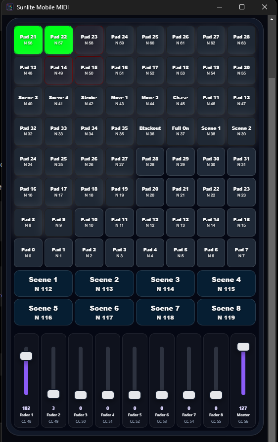

# Sunlite Mobile MIDI

Electron + React mobile MIDI controller for Sunlite Suite 2 and FreeStyler. It lets a phone or tablet control lighting software through a local Wi-Fi web interface and a locally managed virtual MIDI bridge.

Version 0.3 also includes Automation Studio: local audio analysis, CDJ beat/position and HD waveform monitoring through PRO DJ LINK, recording of MIDI training sessions, and assisted or automatic scene triggering.



## How it works

```txt
Phone / tablet
  -> Wi-Fi web controller
  -> Electron app on PC
  -> Automatically managed virtual MIDI bridge
  -> Sunlite / FreeStyler
```

For feedback colors and fader values:

```txt
Sunlite / FreeStyler MIDI OUT
  -> Virtual MIDI bridge
  -> Electron app
  -> WebSocket
  -> Phone / tablet UI
```

## Plug-and-play Windows setup

1. Install Sunlite Mobile MIDI.
2. Open the application. On a new PC, accept the Windows elevation prompt for the MIDI driver.
3. The application silently creates and starts these ports:

```txt
Sunlite Mobile In
Sunlite Mobile Out
```

4. In Sunlite or FreeStyler, select:

```txt
MIDI input  -> Sunlite Mobile In
MIDI output -> Sunlite Mobile Out
```

5. Map the MIDI notes and CC controls to the scenes in that show, then scan the QR code from your phone.

The virtual bridge installation, port creation, minimized startup and reconnection are automatic. Mapping scenes cannot be inferred globally because every Sunlite show has different pages and buttons; it is a one-time operation per show.

### FreeStyler profile

In the **Conexión** tab, choose **FreeStyler**. The selection persists across restarts.
The application keeps separate controller mappings, automation settings, sessions and
models for each software. Existing Sunlite files stay in their original location;
FreeStyler files use `profiles/freestyler/` under the Electron user-data directory.
Switching profiles starts in Manual mode; stop any recording before switching.
Only one lighting application should listen to the shared MIDI port at a time.

In FreeStyler, open **Setup → FreeStyler Setup → External Control → MIDI Control**.
Select **Sunlite Mobile In** as input and optionally **Sunlite Mobile Out** as output.
Start MIDI, enable Learn, select a function's Note IN field, operate its control in
this app and save the assignment. Map faders to the corresponding continuous functions.
The FreeStyler profile sends Note On with velocity zero for button release, matching
its default Key Up setting; Sunlite retains Note Off. If you changed FreeStyler's Key Up,
restore that default. For automation, use Page independent mappings so a page change
cannot silently change the learned command's meaning. Feedback requires explicit
configuration in FreeStyler; opening the return port alone does not confirm feedback.

Reference: [FreeStyler MIDI interface documentation](https://www.freestylersupport.com/wiki/external_control:midi:midi_interface).

### MIDI driver distribution

Private development builds currently use loopMIDI as the Windows MIDI 1.0 bridge. The loopMIDI author's published terms prohibit redistribution without prior written consent. A public or commercial installer must therefore use the licensed virtualMIDI redistributable MSI, supplied under a license from its author, or a separately developed and Microsoft-signed MIDI driver. The provisioning code is isolated so that either driver package can be inserted without changing the controller or automation engine.

## MIDI routing

Use separate ports:

```txt
App -> Sunlite Mobile In -> Lighting software
Lighting software -> Sunlite Mobile Out -> App feedback
```

Do not use the same port for both input and output.

## MIDI Router (channel split and merge)

`src/router/` is a MIDI router that runs on its own, without Electron. It covers the
routing problems the controller itself does not:

- **Merge** — several applications write to their own virtual ports and the router
  forwards everything into a single physical device. Only the router ever opens that
  device, which is the whole point on Windows: MIDI drivers there are frequently
  single-client, so the second application to ask for the port just fails to open it.
- **Split** — one input is copied to several destinations, optionally filtered by
  channel, note range, controller number or message type.

The engine routes any graph of ports you hand it. The guided setup in
`src/shared/router-setup.ts` builds the one shape people actually ask for: N programs on
one side, one device on the other, in both directions.

```txt
App A  ->  Router Entrada 1  ─┐                ┌─  Router Salida 1  ->  App A
App B  ->  Router Entrada 2  ─┼─>  device  ─>  ┼─  Router Salida 2  ->  App B
App C  ->  Router Entrada 3  ─┘                └─  Router Salida 3  ->  App C
                                    (each Salida takes every channel, or only its own)
```

In **Conexión → Comparte un dispositivo MIDI**:

1. Select the device and the number of programs (2–8). Matching input/output names
   are paired automatically, including Windows numbered endpoints. If pairing fails,
   the return-output selector appears directly in the assistant.
2. Review the exact MIDI ports shown for each program and press **Compartir y arrancar**.
   The app saves the setup, prepares its virtual ports and starts the router. A startup
   failure keeps the saved setup available for retry.
3. In each program's MIDI settings, select **Router Salida N** as input and
   **Router Entrada N** as output. Use the copy buttons beside each name.

Use **Opciones avanzadas → Repartir por canales** to give each program its own channel
selection. **Cambiar dispositivo o programas** reopens the assistant with the saved
choices; applying while running briefly stops the router to prepare its ports.
**Editar puertos y rutas** exposes the manual editor: add ports first, then routes.
Changes are staged until **Aplicar cambios**, **Guardar y arrancar** or **Guardar borrador**;
**Descartar cambios** restores the saved setup. Incomplete drafts can be saved, while
routing errors and feedback loops prevent startup.

Only the router opens the physical device; each program opens its own virtual pair.
All channels and message types are copied by default. Channel splitting is optional
under **Opciones avanzadas**. Disable automatic MIDI Thru in the programs to avoid echoes.
Use **Actualizar dispositivos** after plugging in a controller. Missing connections and
virtual-port preparation errors are shown in the panel.

### Both directions

A controller is not a one-way device: it lights its pads, moves its motorised faders and
answers its own transport buttons from what the software sends back. So each program gets
two virtual ports, `Router Entrada N` to write into and `Router Salida N` to listen to.

Two ports and not one, because a loopMIDI port hands everything written to it back to
every listener, the writer included: a single port carrying both directions is a feedback
loop. Their names are also unrelated rather than one deriving from the other, since ports
resolve by substring — `Router Entrada 1 Retorno` would satisfy a definition asking for
`Router Entrada 1`, and the two could swap devices under the router's feet.

The direction toward the device is never filtered by channel: a program answering on a
channel other than the one it was given would otherwise be dropped in silence, which
debugs far worse than the crosstalk it avoids.

The wizard requires both directions. One-way setups remain available through manual
port/route configuration and the underlying builder. Physical endpoints selected by the
wizard match their full enumerated names so another similarly named device is not opened.

The virtual ports are created through the same loopMIDI bridge the controller uses, so
the redistribution constraint in [MIDI driver distribution](#midi-driver-distribution)
applies here too. `src/router/loop-midi.ts` is the only file that knows which bridge is
in use.

### Commands

```bash
bun run router:list
```

Lists every MIDI input and output Windows exposes, with the exact names to put in the
configuration file.

```bash
bun run router -- init --in "APC mini mk2" --out "APC mini mk2"
```

Writes a starter configuration to `%APPDATA%/sunlite-midi-router/midi-router.config.json`
with three applications merged into the physical output and the physical input split by
channel into three virtual ports. Use `--config <path>` for a different location and
`--force` to overwrite.

```bash
bun run router -- check
```

Validates a configuration without opening a single device. It reports unknown or
misused ports, routes that block every message type, and **feedback loops**: a loopMIDI
port named `X` is exposed as both an input and an output, so a chain of routes can close
on itself and flood the driver.

```bash
bun run router:run
```

Runs the router with the message monitor enabled:

```txt
11:32:04.115  IN  app-a                        CH  1  Note On    C4   127
11:32:04.115  OUT device-out (merge-a)         CH  1  Note On    C4   127
11:32:04.320  IN  device-in                    CH  4  CC         21   64
```

Drop `--monitor` for a quiet run. `Ctrl+C` sends All Notes Off to every destination
before closing the ports.

### Route options

Each route in the configuration file has:

| Field                                                   | Meaning                                                                                                 |
| ------------------------------------------------------- | ------------------------------------------------------------------------------------------------------- |
| `source`, `destination`                                 | Port ids declared in the `ports` array                                                                  |
| `channels`                                              | `"omni"` or a list of 1-based channels                                                                  |
| `filters.allow`                                         | `note`, `cc`, `programChange`, `pitchBend`, `aftertouch`, `sysex`, `clock`, `transport`, `systemCommon` |
| `filters.noteRange`                                     | Inclusive note range                                                                                    |
| `filters.controllers`                                   | Allowed controller numbers, or `null` for all                                                           |
| `filters.velocityRange`                                 | Note-on velocity gate                                                                                   |
| `transforms.channelRemap`                               | Rewrite the outgoing channel, or `null` to keep it                                                      |
| `transforms.transpose`                                  | Semitones; notes pushed outside 0-127 are dropped                                                       |
| `transforms.velocityScale`, `transforms.velocityOffset` | Velocity curve, clamped to 1-127                                                                        |
| `enabled`                                               | Disable a route without deleting it                                                                     |

Behaviour worth knowing:

- Held notes are tracked per route, so a note-off always releases the note that was
  actually played even if the transpose or channel remap changed in between.
- The release form is preserved: a note-on with velocity 0 stays a note-on with velocity
  0, which is what FreeStyler expects.
- SysEx and MIDI clock pass through untouched. Active sensing is dropped, because it is
  pure heartbeat traffic that would otherwise reach every destination.
- Devices are re-scanned every few seconds, so unplugging and reconnecting a controller
  recovers on its own, as does a device still held by another application at startup.
- A source that exceeds 5000 messages per second is throttled and reported, as a guard
  against a loop closed by hardware MIDI thru rather than by the configuration.

### Router tests

```bash
bun run test:router
```

Covers the routing matrix - fan-out, channel split, merge, remap, transpose with held
notes, velocity, filters, SysEx passthrough, panic, validation and configuration
normalization - with no MIDI device attached.

## Controller layout

The app renders the active MIDI console from a controller model definition in:

```txt
src/shared/midi-controllers/
```

The current default model is `akai-apc-mini-mk2`. Additional console models should be
created as their own files, then added to `CONTROLLER_MODELS` in
`src/shared/controller-models.ts`.

- 8×8 pad matrix using MIDI notes 0–63, arranged from the bottom row upward.
- Top row: notes 56–63; bottom row: notes 0–7.
- Right-hand scene buttons: notes 112–119.
- Bottom buttons: notes 100–107; corner button: note 122.
- Faders 1–8: CC 48–55; Master: CC 56.

These are controller addresses, not predefined lighting functions. Assign each one
inside Sunlite or FreeStyler to your show. The legacy automation protections use
notes 36 and 37 as blocked notes and 42 as strobe; review them against your actual
mapping, and configure protected CCs (for example your master dimmer) as needed.

## MIDI feedback colors

Incoming MIDI note velocity controls the pad color using the APC RGB velocity table.

Examples:

```txt
Velocity 0   -> off
Velocity 9   -> orange
Velocity 21  -> green
Velocity 45  -> blue
Velocity 96  -> orange
Velocity 127 -> dark brown
```

The MIDI channel controls LED behavior or brightness. The velocity controls the color.

## Automation Studio

Automation Studio runs locally and does not upload audio or training data. It combines:

- HD track waveforms, playback position, beat and bar data retrieved from compatible CDJs through PRO DJ LINK.
- Optional audio captured from a DJ mixer USB input or REC OUT connected to an audio interface.
- MIDI actions sent from this application to the selected lighting software.
- A lightweight example-based model with confidence and safety limits.

The installed application does **not** require Python or a JDK. PRO DJ LINK support runs inside the Electron application.

### Rekordbox on the same Windows PC

Automation Studio can mirror the full waveform and playback marker shown in the
rekordbox window, without CDJ hardware or PRO DJ LINK ports. Keep rekordbox open and
choose **Vista general estándar (2 decks)** for its standard two-player Export view.
For another layout, click **Seleccionar deck 1–4** and drag around each deck's full
waveform and playback marker in the preview. Drag the four corners to resize a selected area, or the center arrow icon to move it. Use **Mostrar/Ocultar waveform** to toggle a configured deck, and **Eliminar selección** to remove its saved area. The selected regions are saved locally
and the cropped views can also be seen from the phone controller. If rekordbox is
minimized or its window layout changes, restore it or adjust the selected regions.

This is a visual capture of the rekordbox window. It does not provide track metadata,
beat data, audio features, or precise transport events to the automation engine. If
rekordbox plays through a Windows audio output on this PC, select **Audio del PC (Rekordbox)**
under **1. Fuente de audio** and click **Iniciar audio**. This
supplies real system audio to training and automation. If rekordbox plays through an
external mixer/controller instead, select its USB/REC OUT audio input. Compatible CDJs
can also provide player data as described below.

### CDJ and mixer connection

1. Connect the compatible CDJ players, DJ mixer, and Windows computer to the same wired Ethernet switch.
2. Use rekordbox-analyzed tracks so the application can retrieve their HD waveform and beat grid.
3. Open Automation Studio and wait for the loaded track waveform to appear.
4. Optionally connect the mixer audio using its USB driver or REC OUT through an audio interface. This lets the model react to the final mixed signal as well.
5. Click **Empezar entrenamiento**. The application first switches to **Manual**. Use **Ir al Controlador** to record actions with the buttons and faders in this app. Actions performed only inside Sunlite or FreeStyler are not training examples; MIDI LED feedback is recorded for review only.
6. Return to Automatización and click **Finalizar y aprender** to save the session and train the local model. Then test **Asistido** before enabling **Auto**. These modes require training examples and a live audio or playing CDJ source; their unavailable state explains the missing prerequisite.

To use an existing model, start the audio without recording another session. Audio
selection and capture controls stay visible. Errors remain on screen until you retry
an action. When the source disappears during recording, reconnect the same audio
input or finalize the session before choosing another source. Saved sessions open
their review timeline with keyboard focus; editing and deletion are unavailable
while a recording is in progress.

To obtain detailed player state and waveform data, the application announces itself as a virtual PRO DJ LINK device. Only one application can normally own the required network ports, so rekordbox or another PRO DJ LINK integration may conflict on the same computer.

### Automation safety

- Notes `36` and `37` retain the legacy Blackout/Full On protections; confirm their functions in your show.
- Note `42` is treated as strobe and receives an additional cooldown.
- Manual MIDI input suspends automatic output temporarily.
- Temporal note/scene decisions follow the beat within the bar demonstrated during training when CDJ beat data is available. Legacy models retain first-beat quantization. Audio-only timing estimates the pulse; it does not claim to identify the bar's first beat.
- Automatic output requires a trained model, a live CDJ waveform or mixer audio, and the configured confidence threshold.
- Contexts that are too different from the recorded training examples remain below the automatic confidence threshold, even when the nearest examples agree on an action.
- Sessions and the model are stored in `automation/` inside the active software profile.
- Training and inference use a fresh, playing deck consistently for both waveform and beat. The preferred deck is respected; without a preference, on-air/master decks take priority. Live mixer audio can also provide features when a CDJ supplies beats without waveform data.
- Stale audio, stopped decks and MIDI button releases do not create training examples.
- Invalid examples are filtered when loading or training; model replacement uses a temporary file. Confidence also requires support from multiple nearby examples.
- Repeat cooldown applies to each action, including when other actions occur between repetitions.
- Faders have a separate update interval (100 ms by default) and bounded smoothing; protected CCs and manual override still apply. Notes and strobes keep their own cooldowns. The app learns MIDI mappings from demonstrations without assuming which note or CC controls strobe intensity in Sunlite/FreeStyler.

### Temporal imitation learning

New training examples include causal, tempo-relative musical context: relative energy,
band balance, energy/brightness trends, bass changes, pulse activity and progression
through a rising, falling or stable-energy phase. Song name, track ID and absolute
playback position are excluded from prediction. A similar build on another track can
therefore select demonstrated scene notes or gradually interpolate demonstrated CC
values instead of replaying a saved song timeline. Phase names are heuristic audio
descriptions, not guaranteed recognition or advance knowledge of every drop.

Audio analysis is sent every 50 ms and recorded at most every 100 ms. CDJ waveform
features use only current/past segments. Context resets after source loss, pause,
track replacement or a seek; temporal models wait for fresh history before acting.
Idle contexts are collected from stretches with no demonstrated actions and can
veto unfamiliar discrete decisions. Increasing canvas resolution does not change
the model, and original WAV/MP3 audio is still not saved.

Models use version 2 and retain compatibility with version 1 models and sessions.
Re-training can derive context from older recorded audio where enough history exists;
new CDJ-only sessions also store context traces. The 8000-example budget is balanced
across up to 64 recent recording sessions so one dense fader session does not replace
all other music. At least five valid examples are needed, and each inferred action
needs support from similar demonstrations.

Record different songs in separate sessions, including quiet passages, builds,
transitions and drops, and repeat the choices you want generalized. The UI reports
temporal-example/session counts and, with multiple sessions, leave-session-out
coverage, note accuracy, CC error and unwanted discrete predictions on idle contexts.
These reference scores use a 62% confidence threshold and test only recorded sessions;
they are not a certification for arbitrary music. Repeated recordings of the same
song in different sessions are not an independent song test. Verify Asistido on music
outside the training set before relying on Auto for unattended output.

### Training quality

The local model learns examples of your choices; it does not generate a lighting show
from fixture definitions or understand every song. Record representative quiet,
build-up and energetic passages and repeat useful scene choices in several contexts.
At least five valid examples are required to predict; one isolated matching action
cannot produce high confidence. Check Assisted suggestions, remove incorrect examples,
and review protected notes/CCs against your own mapping before enabling Auto.
Train each software profile separately. A mapping change within a profile can change
what an old example does; review or delete affected sessions before retraining.

### Training data review

The live audio graph is hidden by default. Use **Ver detalles de audio** when needed; a
saved session opens its review timeline automatically. Only the active waveform source
is shown: Rekordbox on this PC or a connected CDJ.

Select a saved session to display its spectrogram, beats and MIDI actions. Incorrect actions can be excluded from the model, and the model is immediately rebuilt without those examples.

## Development

See [Project structure and architecture](docs/ARCHITECTURE.md) for module ownership,
dependency rules and file-size conventions.

```bash
bun install
bun run dev
```

`bun run dev` keeps the app running while watching the source code. Renderer changes
are applied with Vite hot module replacement, and main-process changes recompile and
restart Electron automatically. Use `bun run start` to run a regular production build.

### Native modules

`rebuild:electron` first checks and completes the Electron binary installation. This
also repairs installs where the package is present but its download/install step did
not finish. `dev`, `start` and Windows packaging run this step automatically.

`rebuild:electron` uses `electron-rebuild -f -o better-sqlite3`. The `-o` matters: it
restricts the rebuild to that one module. The similar-looking `-w` is _additive_, so
with `-f` it drags every native module in the tree through node-gyp, which then needs a
Visual Studio installation to build them from source.

Only `better-sqlite3` actually needs it, because it is a V8-ABI addon. `@julusian/midi`
(the MIDI backend behind `easymidi` and the router) ships Node-API prebuilds, and
Node-API is ABI-stable across Node and Electron, so rebuilding it is unnecessary — and
it fails anyway, since it uses `pkg-prebuilds`, a prebuild format electron-rebuild does
not recognise.

## Format and check

```bash
bun run format
bun run check
```

## Build

```bash
bun run dist:win
```

PRO DJ LINK is compiled with the Electron main process, so the Windows build does not require Python or a separate sidecar.

Build files are generated in:

```txt
release/
```

## Change MIDI port names

PowerShell:

```powershell
$env:MIDI_OUTPUT_NAME="My MIDI Input Port"
$env:MIDI_INPUT_NAME="My MIDI Feedback Port"
bun run start
```

CMD:

```cmd
set MIDI_OUTPUT_NAME=My MIDI Input Port
set MIDI_INPUT_NAME=My MIDI Feedback Port
bun run start
```

## Change HTTP port

The default port is `3000`. If it is busy, the app tries the next available port.

To set a preferred port:

```powershell
$env:PORT="3005"
bun run start
```

## Firewall

The phone must be on the same Wi-Fi network as the PC. Windows Firewall must allow the app, Node, or Electron to accept private network connections.

## Updates

For update hosting details, see:

```txt
UPDATE_SETUP.md
```
